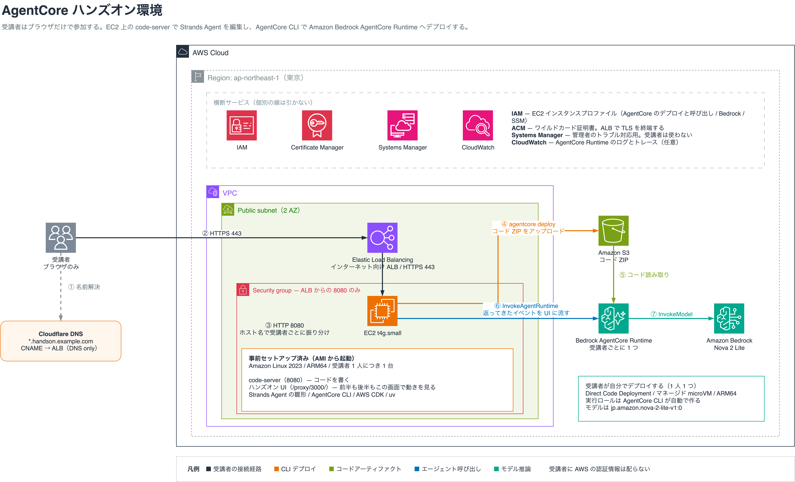
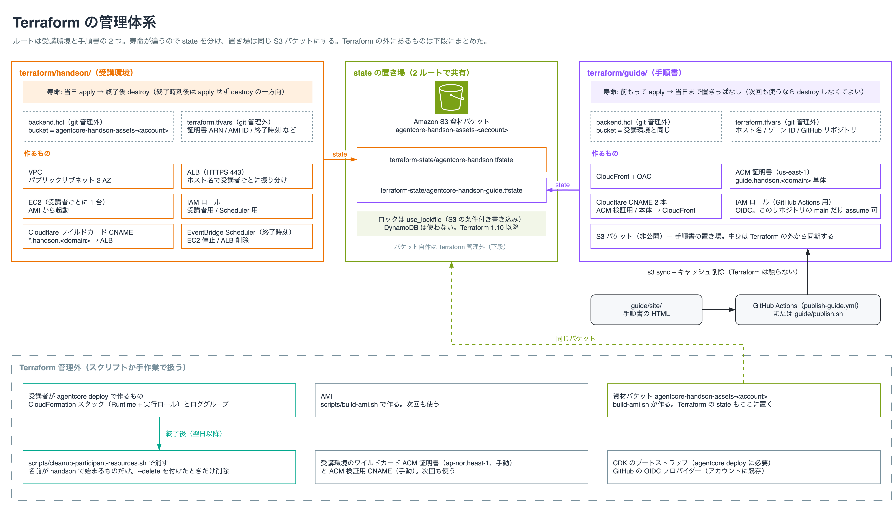

# AgentCore ハンズオン環境

Amazon Bedrock AgentCore のハンズオンを開く側のための環境です。受講者にはブラウザだけで参加してもらい、AWS の認証情報も手元の開発環境も配りません。環境は Terraform で作り、終わったら消します。



## この環境でできること

受講者は配られた URL を開いてパスワードを入れると、ブラウザの中で VS Code（code-server）が使えます。そこに Strands Agent の雛形と、エージェントの動きを見せる画面が入っています。

まず手元でエージェントを動かしてループの仕組みを見て、ツールを 1 つ足して挙動が変わるのを確かめ、最後に `agentcore deploy` の 1 行で自分のエージェントを AgentCore Runtime に載せます。載せたあとも、呼び出しの様子は同じ画面で見られます。

主催者は開催前に `terraform apply` で受講者数ぶんの環境をまとめて作り、終わったら `terraform destroy` で消します。受講者向けの手順書は別の Terraform で S3 と CloudFront に置き、前もって公開しておきます。

## 設計の要点

受講者に AWS の認証情報を配りません。EC2 にインスタンスプロファイルを付けてあるので、EC2 の中で動く AWS CLI も `agentcore deploy` もその権限で動きます。受講者が IAM ユーザーを受け取ったり、アクセスキーを設定したりする手順がまるごと要りません。

受講者の PC に何もインストールしません。入口は ALB で HTTPS を終端し、`user01.handson.example.com` のようなサブドメインで受講者ごとの EC2 に振り分けます。必要なのはブラウザだけなので、会社支給の PC でソフトを入れられない人も同じ手順で進められます。

開発環境は AMI に焼いておきます。code-server や AgentCore CLI のセットアップを起動のたびに走らせると、当日に人数ぶんの待ち時間と失敗が出ます。事前に AMI を作っておけば、起動した時点で使える状態になります。

後片付けは仕組みで担保します。終了時刻を Terraform の変数で渡すと、その時刻に EC2 の停止と ALB の削除が自動で走り、受講者が作った Runtime は棚卸しスクリプトで名前を絞って消します。

## ディレクトリ構成

```
.
├── README.md                     このファイル
├── AGENTS.md                     作業ルールと現在の状況（CLAUDE.md はこれを読み込むだけ）
├── docs/
│   ├── curriculum.md             ハンズオンの中身と組み立て
│   ├── architecture.md           構成の詳細と、そう決めた理由
│   ├── operations.md             事前準備・当日・後片付けの手順
│   └── images/                   構成図、ハンズオンの流れ、Terraform の管理体系（drawio と png）
├── terraform/
│   ├── handson/                  受講環境（VPC、ALB、EC2、Cloudflare の CNAME、自動停止）
│   └── guide/                    手順書の配信（S3、CloudFront、証明書、Actions 用のロール）
├── guide/
│   ├── src/                      受講者向けの手順書（Astro Starlight。本文は src/content/docs/ の MDX）
│   └── publish.sh                手順書を S3 に同期してキャッシュを消す
├── handson-agent/                受講者が触る Strands Agent の雛形
├── handson-ui/                   エージェントの動きを見せる画面（React + FastAPI）
├── agentcore/                    agentcore CLI の設定と CDK のコード
├── scripts/
│   ├── build-ami.sh              AMI を焼く
│   ├── setup-instance.sh         AMI に入れるものを揃える（build-ami.sh が流す）
│   ├── cleanup-participant-resources.sh  受講者が作ったものを棚卸しして消す
│   └── run-on-participants.sh    全台で deploy やモデル呼び出しを一斉に流す（人数ぶんの試し用）
└── .github/workflows/
    └── publish-guide.yml         guide/ が main に入ったらビルドして自動で配信する
```

Terraform は受講環境と手順書で寿命が違うので、ルートを 2 つに分けています。state はどちらも S3 に置きます。



## 前提条件

- AWS アカウント（主催者のもの 1 つ。受講者ぶんは要りません）
- Terraform 1.10 以降（S3 バックエンドのロックに `use_lockfile` を使うため）
- 独自ドメインと、それを管理している Cloudflare のゾーン（サブドメインを 1 つ使います）
- ハンズオンで使うリージョンで Amazon Bedrock のモデルアクセスが有効になっていること
- GitHub のリポジトリ（手順書の自動配信に GitHub Actions を使います）

## ドキュメント

- [ハンズオンの中身](docs/curriculum.md)。何をやってもらうか、なぜその順番か
- [構成の詳細](docs/architecture.md)。何をどう組んでいるか、なぜその選択をしたか
- [運用手順](docs/operations.md)。開催前の準備、当日の流れ、後片付け

## ステータス

受講環境、AMI、手順書の配信、後片付けの仕組みまで main に入っています。2026-10-29 に 12 人分の環境で勉強会を開き、終了時刻での自動停止と後片付けまで通しました。残りは 30 人分での確認です。作業は [Issue](../../issues) で管理しています。

## ライセンス

[MIT License](LICENSE) です。
