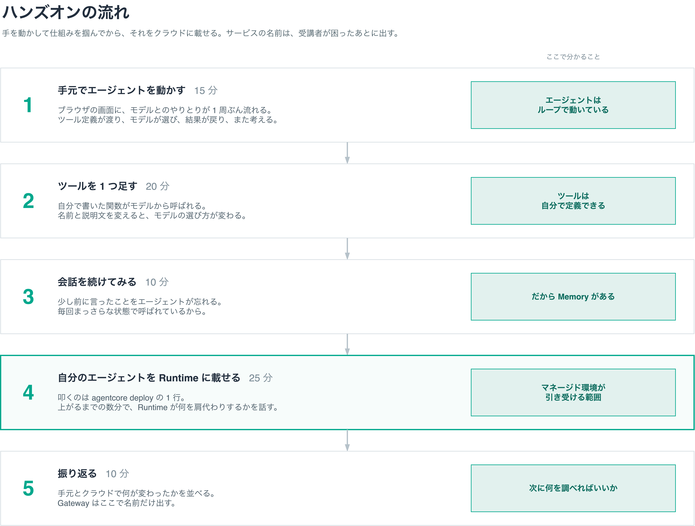

# ハンズオンの中身

環境の構成は [architecture.md](architecture.md) を参照してください。ここではハンズオンで何をやってもらうかを書きます。

## ねらい

受講者に持ち帰ってほしいものは 2 つあります。

ひとつはエージェントそのものの仕組みです。モデルにツールの一覧が渡り、モデルがどれを呼ぶか決め、結果を戻してまた考える、というループが回っていること。これが分かると、世の中のエージェントの話がだいたい読めるようになります。

もうひとつは AgentCore が何を肩代わりしてくれるのかです。Runtime、Memory、Gateway がそれぞれどの困りごとを引き受けるのかを、名前と一緒に押さえてもらいます。

対象は初学者なので、サービスの説明から入りません。先に手を動かして動くものを見て、困ってから名前を知る順番にします。「会話を続けたら忘れてしまった、だから Memory がある」という流れなら、はじめて聞く名前でも引っかかりません。

## 流れ

| # | やること | 時間 | ここで分かること |
|---|---|---|---|
| 1 | 手元でエージェントを動かす | 15 分 | エージェントはループで動いている |
| 2 | ツールを 1 つ足す | 20 分 | ツールは自分で定義できる |
| 3 | 会話を続けてみる | 10 分 | だから Memory がある |
| 4 | 自分のエージェントを Runtime に載せる | 25 分 | マネージド環境が引き受ける範囲 |
| 5 | 振り返る | 10 分 | 次に何を調べればいいか |

### 1. 手元でエージェントを動かす

用意してある Strands Agent の雛形を、EC2 の上でそのまま実行します。ブラウザの画面に、モデルとのやりとりが 1 周ぶん流れます。ツール定義が渡り、モデルがツールを選び、実行結果が戻り、それを踏まえてモデルが答える、という順番が目で見えます。

ここで「エージェント」という言葉の中身が、魔法ではなくループだと分かります。

### 2. ツールを 1 つ足す

関数を 1 つ書いて、ツールとして登録します。自分で書いた関数がモデルから呼ばれる瞬間が、たぶん一番おもしろいところです。

余裕があれば、ツールの名前や説明文を変えて、モデルの選び方が変わることも試します。説明文がモデルへの指示になっている、という感覚を持って帰ってもらえます。

### 3. 会話を続けてみる

何度かやりとりすると、少し前に言ったことをエージェントが忘れます。毎回まっさらな状態で呼ばれているからです。

ここで Memory の名前を出します。困ったあとなので、何を解決するものなのかがそのまま伝わります。

### 4. 自分のエージェントを Runtime に載せる

受講者が叩くのは `agentcore deploy` の 1 行だけです。裏側では CDK が動くので数分かかります。code-server で開いているワークスペース直下（`agentcore/` がある場所）でターミナルを開き、そこでコマンドを打ちます。

その数分を Runtime の解説に充てます。手元で動かしていたものを他の人に使ってもらうには、サーバーを立てて、認証して、同時アクセスに耐えて、落ちたら上げ直す必要がある。それを引き受けるのが Runtime だ、という話を、自分のコードが今まさに向こうで起動している状態で聞けます。

デプロイが終わったら、前半と同じ画面から呼び出します。UI から Runtime を呼び、返ってくるイベントを同じように画面に流すので、受講者から見た絵は前半とまったく同じになります。違うのは実行されている場所だけです。さっきまで手元の EC2 で動いていたものが、いまは AWS 側の箱で動いている。それでも見え方は変わらない、という対比がそのまま学びになります。

この仕組みは実際に確かめてあります。`InvokeAgentRuntime` は `text/event-stream` で返し、ツールの呼び出しも結果もテキストの断片もすべて届きます。

ただし Strands のイベントをそのまま返すことはできません。イベントには Agent オブジェクトそのものが入っていて、JSON にできず Python の文字列表現のまま届いてしまいます。そこで画面に出すぶんだけに絞る変換を挟み、その変換をローカル実行と Runtime 実行の両方で共有する形にしました。前半と後半で同じ画面が使えることが、実装の構造として保証されています。

自分専用の Runtime なので、ログもトレースも自分の実行だけが出ます。

### 5. 振り返る

手元とクラウドで何が変わったかを並べます。Gateway の名前はここで出して、次に調べる取っかかりにしてもらいます。

## 教材の作り

### ハンズオン UI

3000 番で動かす画面は、チャット窓ではなくエージェントの動きを見せる画面にします。モデルに何を渡したか、モデルが何を返したか、どのツールが呼ばれて何が返ったか、を上から順に積んでいきます。

**トレースはこの画面だけで見せます。** 前半のローカル実行も、後半の Runtime 実行も、受講者が見るのは同じこの画面です。CloudWatch のコンソールも、汎用のトレース可視化ツールも、ハンズオンの中では開きません。

既存のトレース可視化ツールを使わない理由が 2 つあります。

Jaeger のような汎用のトレース UI は、span の親子関係を追う道具としてはよくできていますが、初学者が初めて開くと情報量に圧倒されます。できることが多いぶん、どこを見ればいいのか分かりません。

CloudWatch GenAI Observability は AWS 内で完結する利点がありますが、見るにはマネジメントコンソールへのログインが必要で、受講者に認証情報を配らない方針と噛み合いません。

ハンズオンで見たいのはループの 1 周だけなので、それだけを出す画面を自前で用意します。実装は Strands のフックでツール呼び出しと推論のイベントを拾い、画面に流す形になります。

### なぜデプロイを含めるか

一度は外す案も検討しました。デプロイの手順そのものに学びは薄く、待ち時間も失敗リスクもあるためです。講師が Runtime を 1 つ立てて全員がそこを呼ぶ形も考えました。同時アクセスはクォータ的に問題なく成立します。

それでも各自でデプロイする形に戻したのは、理由が 2 つあります。

ひとつはトレースです。共有の Runtime を全員で叩くと、30 人分のログが 1 つのロググループに混ざり、自分の実行を探すところから始まってしまいます。初学者にそれをやらせるのは無理があります。1 人 1 つなら自分のログしか出ません。

もうひとつは自分事になることです。用意されたエンドポイントを呼ぶのと、さっきまで手元で動いていた自分のエージェントがクラウドに乗るのとでは、腹落ちの度合いが違います。

待ち時間は解説に充てれば無駄になりません。失敗リスクは、`cdk bootstrap` もモデルアクセスも権限も主催者側で済ませておき、受講者が叩くコマンドを 1 行に絞ることで下げます。当日踏みうるエラーはリハーサルで洗い出します。

## 準備するもの

- Strands Agent の雛形プロジェクト（ツールを 1 つ足せば動く状態にしておく）
- ハンズオン UI（エージェントの動きを可視化する画面）
- `agentcore deploy` が 1 行で通るところまで設定を済ませた状態
- 説明資料（Runtime の解説はデプロイの待ち時間に話す）

## 確かめたこと

**Runtime のストリーミング応答は期待どおり流れます。** 変換を挟んだうえで、ローカル実行と同じ形のイベントが届くことを確認しました。前半と後半で同じ画面を使うという前提は成立しています。

**Nova 2 Lite はツールを正しく選びます。** 備品の質問では毎回ツールを呼び、結果を踏まえて答えます。ツールが要らない質問では呼びません。日本語の応答も自然でした。

## まだ確かめていないこと

- `agentcore deploy` が受講者の権限で 1 行で通るか（主催者の権限では通ることを確認済み）
- デプロイにかかる時間の実測（解説の尺を決めるため）
